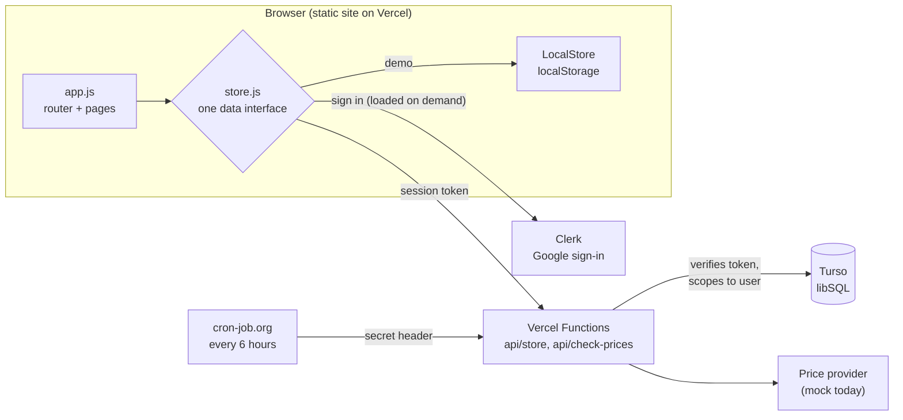

# GiftingSmart

[](https://github.com/SuzanneV0/giftingsmart/actions/workflows/ci.yml)

Keep gift-giving on budget for any occasion: birthdays, holidays, baby showers, housewarmings.


- Create an event (e.g. "Lauren's birthday", "Christmas 2026", "Jane's baby shower")
- Set **one budget for the whole event**, or **a budget per person**
- Build a shopping list. Gift prices are tracked over time, and you get an alert when something goes on sale or reaches your target price
- Mark gifts as bought with the amount you actually spent
- A progress bar at the top of each event shows spent / still on the list / budget
- Warnings before a purchase takes you near (90%) or over budget, and when your whole list would go over

Plain HTML/CSS/JS on Vercel, with [Clerk](https://clerk.com) for Google sign-in, a [Turso](https://turso.tech) database, and a few Vercel Functions for the API and the scheduled price checker.

**Live:** [giftingsmart.shop](https://giftingsmart.shop). Use **Try the demo** to explore with sample data, no account needed.

## How it's built

### Architecture



| Layer | Technology |
|---|---|
| Front end | Plain HTML, CSS and JavaScript (ES modules). No framework or bundler |
| Sign-in | Clerk (Google only), loaded only when someone signs in or is already signed in |
| API | Vercel Functions (Node) in `api/`, running in Montréal (`yul1`, set in `vercel.json`) next to the database: the data API, the price checker and account deletion |
| Database | Turso (libSQL/SQLite) in Canada. Tables are created on first use |
| Scheduling | cron-job.org calls the price checker every 6 hours with a shared secret |
| Hosting | Vercel with a custom domain; a small Node build script generates the info pages, sitemap and config |

**Lighthouse** (October 2026, live site): 100 for performance, accessibility, best practices and SEO, on both mobile and desktop.

### Key decisions

- **One data interface, two implementations.** `ServerStore` and `LocalStore` expose the same async API, so the whole UI runs unchanged against the real database or against `localStorage`. That one choice gives local development with no setup and the no-account **Try the demo** mode on the live site.
- **Every request is checked on the server.** The browser never talks to the database. Each API call carries the Clerk session token; the function verifies it, then scopes every query to that user's rows. Writes accept only known columns, a gift's person must belong to the same event, and `tests/api-store.test.mjs` checks that one user can't read, change or delete another's data.
- **Shared pricing logic.** Sale detection and the simulated price model live in one plain ES module (`shared/pricing.js`) that runs both in the price-checker function and in the browser's demo mode. A drop counts as a sale only if it's at least 5% below the last price *and* the lowest in 30 days, which avoids alerting on noise.
- **Pluggable price providers.** The checker talks to a provider interface (`api/_providers.js`). The current `mock` provider produces deterministic, realistic price movement; a real API (Keepa, SerpApi, …) is one object plus a setting.
- **Rate limiting.** User-triggered price checks are limited to 20 per 10 minutes per account; the check and the insert happen in one transaction, so concurrent requests can't slip past the count.
- **Privacy by design.** No ads; Google Analytics only loads after a visitor accepts the cookie banner, and page views are anonymised (generic titles, no IDs). Fonts are self-hosted, and Clerk's script is only loaded for someone signing in or already signed in, so other visitors' browsers contact only this site. The database stores a Clerk user ID, never a name or email. The Google profile photo is never loaded (initials instead). Users can download all their data or delete their account, which removes every row and the Clerk account.
- **Strict browser security.** A Content Security Policy allows scripts and network calls to this site and Clerk only (plus analytics after consent); all user text is escaped before rendering, gift links must be `http(s)`, and the API rejects browser requests from other websites.
- **Accessible and responsive.** Semantic HTML, focus moved to new content on each page change, live-region announcements for budget warnings, a keyboard-friendly hamburger menu below 1024px, light/dark themes (system default or manual, with no flash on load), and colour pairs checked against WCAG AA contrast.
- **Inclusive by default.** Occasion suggestions span many traditions (Hanukkah, Eid, Diwali, Lunar New Year, Vaisakhi, Nowruz and more), each labelled with the year it next occurs.

### Worth a look in the code

| File | Why |
|---|---|
| [`js/budget.js`](js/budget.js) | Pure budget maths: per-event and per-person budgets, and the "this purchase would put you over" warnings |
| [`js/store.js`](js/store.js) | The shared data interface and its two implementations |
| [`shared/pricing.js`](shared/pricing.js) | Deterministic price simulation and the sale-detection rule |
| [`api/check-prices.js`](api/check-prices.js) | Two auth paths (user token or cron secret), rate limit, provider calls, alerts |
| [`api/store.js`](api/store.js) | The data API: every operation scoped to the signed-in user, with per-table allowed columns |
| [`scripts/build.mjs`](scripts/build.mjs) | Build step that generates pages and refuses to publish secret keys |
| [`tests/`](tests/) | 34 tests: budget maths, sale-detection rules, and the data API's per-user isolation, run by GitHub Actions on every push |
| [`docs/privacy-audit.md`](docs/privacy-audit.md) | Privacy audit and security review, with findings and fixes |

### What I'd add next

- End-to-end tests with Playwright for the main flows (create event, add gift, mark bought, over-budget warning), alongside the existing unit tests.
- A real price provider, with per-store parsing and caching.
- Email alerts for sales, sent from the price checker.
- Shared events, so a family can plan one gift list together.

## Demo for visitors

The live site has a **Try the demo** button (home page, login page and menu). It runs the app on sample data kept only in the visitor's browser (no account, nothing sent to the server) and shows a banner with an **Exit demo** link. Prices throughout are simulated by the `mock` price provider, and the site says so in the footer, on event pages, the About page and the Terms.

## Run it locally

```bash
python -m http.server 5173
```

Run the tests (Node 22.12 or later):

```bash
npm install
npm test
```

Open http://localhost:5173. With `config.js` left empty, the app runs in **demo mode**: "Continue with Google" signs you in as a demo user, data stays in your browser, and sample events are created. "Check prices now" moves a simulated clock forward six hours so you can watch prices move and sale alerts appear.

## Project layout

| Path | What it is |
| --- | --- |
| `index.html`, `styles.css`, `icon.svg` | Page shell, SEO tags and styles (light and dark) |
| `theme.js` | Applies the saved light/dark choice before the page draws |
| `config.js` | Clerk publishable key (public); filled in at build time on Vercel |
| `pages/` | Content for the About, Privacy, Cookies, Terms and Legal pages |
| `scripts/build.mjs` | Vercel build: copies the site to `dist/`, generates the info pages and sitemap, writes `config.js`. **Set your name, contact email and province in `SITE` here.** |
| `scripts/screenshot.mjs` | Re-captures `docs/screenshot.png` from the demo in a separate headless Chrome |
| `scripts/render-images.sh` | Re-renders `og-image.png` and `apple-touch-icon.png` from the HTML sources beside it |
| `fonts/` | Self-hosted fonts (with their licences), so visitors never contact third parties |
| `docs/privacy-audit.md` | Privacy audit, security review and action items |
| `tests/`, `.github/workflows/ci.yml` | Unit tests (Node's built-in test runner) and the CI workflow that runs them, syntax-checks the scripts and runs the build |
| `manifest.webmanifest`, `icon-*.png` | Lets visitors add GiftingSmart to their home screen |
| `js/app.js` | Router and pages: home, log in, my account, my events, new event, event |
| `js/store.js` | Data layer: `ServerStore` (real, Clerk + API) and `LocalStore` (demo) |
| `js/budget.js` | Budget maths and over-budget warnings |
| `api/_lib.js` | Database connection and schema, Clerk session check, shared helpers |
| `api/store.js` | Data API used by the app (events, people, gifts, alerts, export) |
| `api/check-prices.js` | Records prices and creates sale alerts (signed-in user, or cron-job.org with the secret) |
| `api/delete-account.js` | Deletes the signed-in user's data and their Clerk account |
| `api/_providers.js` | Price providers (`mock` today) |
| `shared/pricing.js` | Sale detection and the mock price model (shared by server and browser) |

## Connect sign-in and the database

1. **Clerk**: create an application with **Google** as the only sign-in option. Copy its publishable key (`pk_…`) and secret key (`sk_…`).
2. **Turso**: create a database and an auth token. The tables are created automatically on first use.
3. **Vercel settings** (Settings → Environment Variables):
   - `CLERK_PUBLISHABLE_KEY`: written into `config.js` at build time (public by design; the build refuses a secret key)
   - `CLERK_SECRET_KEY`, `TURSO_DATABASE_URL`, `TURSO_AUTH_TOKEN`: used only by the functions in `api/`
   - `CRON_SECRET`: a long random string shared with cron-job.org
   - `PRICE_PROVIDER` (optional, default `mock`)
4. **Scheduled price checks**: in [cron-job.org](https://cron-job.org), create a job that sends `POST https://giftingsmart.shop/api/check-prices` every 6 hours with the header `x-cron-secret: <CRON_SECRET>`.
5. **Local development**: with `config.js` left empty the app runs in demo mode. To run against the real API, use `npx vercel dev` with the settings above in `.env.local`.

## Plugging in a real price API

Prices come from `PRICE_PROVIDER` (default `mock`, which simulates realistic prices and sales). To use a real source such as Keepa (Amazon), SerpApi (Google Shopping) or Rainforest:

1. Add a provider to `api/_providers.js` with an async `getPrice(gift)` that uses `gift.url` and/or `gift.name` and returns `{ price, source }` (or `null` if not found).
2. Set `PRICE_PROVIDER=<name>` and the provider's API key in Vercel's settings, then redeploy.

Sale rules live in `shared/pricing.js`: an alert fires when the price drops at least 5% from the last check **and** is the lowest in 30 days, or when it crosses your target price.

## Deploy

Import the repo in Vercel (framework "Other"; `vercel.json` sets the build command and output directory). Only the files listed in `scripts/build.mjs` are published, plus the functions in `api/`; `vercel.json` also sets security headers.

## Notes and next steps

- Alerts appear in the app (bell icon) and, if enabled under My account, as browser notifications while the app is open. Email or push alerts would be a natural next step (e.g. sending from the price checker).
- Prices are checked every 6 hours and may not match the store at checkout.
